# Database Architecture Specification
**Document:** `docs/DATABASE.md`  
**Project Owner:** Demilew Terefe  
**Phase Target:** Phase 2 (Database Engineering — Completed)

---

## 1. Relational Database Principles

Per Section 5 of `PROJECT_INSTRUCTIONS.md`:
- **Relational Schema**: Normalized relational design using strict foreign key constraints (`ON DELETE CASCADE`, `ON DELETE SET NULL`), primary keys, and unique constraints.
- **Timestamps**: Creation (`created_at`) and modification (`updated_at`) timestamps on all persistent entities managed via `TimestampMixin`.
- **Slugs & Search**: Indexed URL-safe slugs (`projects.slug`) and search keys.
- **Normalized Technologies**: Technologies associated with projects are stored in an explicit relational child table (`project_technologies`) rather than arbitrary JSON blobs.
- **File & Media Storage**: Large binary files, images, and PDF documents are never stored directly in PostgreSQL; they reside in local filesystem storage (or S3/Cloud Storage) with metadata and paths recorded in the `media` table.
- **Publishing State Machine**:
  ```python
  class PublishingStatus(str, enum.Enum):
      DRAFT = "draft"
      PUBLISHED = "published"
      ARCHIVED = "archived"
  ```
  Only records with status `PUBLISHED` are returned by public endpoints. The admin interface manages transitions between `DRAFT`, `PUBLISHED`, and `ARCHIVED`.
- **Alembic Migrations**: Linear versioned schema tracking. Version `a1b2c3d4e5f6_phase2_core_database_entities.py` defines all 13 tables.

---

## 2. Entity-Relationship Diagram

```mermaid
erDiagram
    ADMIN_USERS ||--o{ MEDIA : uploads
    PROFILES ||--o{ SOCIAL_LINKS : owns
    PROFILES ||--o| MEDIA : "cv_document"
    PROFILES ||--o| MEDIA : "profile_image"
    PROJECTS ||--o{ PROJECT_TECHNOLOGIES : contains
    PROJECTS ||--o| MEDIA : "featured_image"
    RESEARCH ||--o| MEDIA : "document"
    EXPERIENCE ||--o| MEDIA : "company_logo"
    EDUCATION ||--o| MEDIA : "institution_logo"
    CERTIFICATES ||--o| MEDIA : "certificate_file"

    ADMIN_USERS {
        int id PK
        string email UK "Indexed"
        string hashed_password
        boolean is_active
        boolean is_superuser
        datetime created_at
        datetime updated_at
    }

    PROFILES {
        int id PK
        string full_name
        string headline
        text biography
        string location
        string email
        string phone
        int profile_image_id FK "Nullable"
        int cv_media_id FK "Nullable"
        datetime created_at
        datetime updated_at
    }

    PROJECTS {
        int id PK
        string title
        string slug UK "Indexed"
        text description
        text problem_statement
        text technical_approach
        string github_url
        string live_url
        int image_media_id FK "Nullable"
        boolean featured
        int display_order
        enum status "DRAFT|PUBLISHED|ARCHIVED"
        datetime created_at
        datetime updated_at
    }

    PROJECT_TECHNOLOGIES {
        int id PK
        int project_id FK "Indexed, Cascade Delete"
        string name
    }

    SKILLS {
        int id PK
        string name
        enum category "Frontend|Backend|DevOps|Other"
        int display_order
        string icon_name
        enum status "DRAFT|PUBLISHED|ARCHIVED"
        datetime created_at
        datetime updated_at
    }

    EXPERIENCE {
        int id PK
        string company
        string role
        text description
        date start_date
        date end_date
        boolean is_current
        string location
        int display_order
        enum status "DRAFT|PUBLISHED|ARCHIVED"
        datetime created_at
        datetime updated_at
    }

    EDUCATION {
        int id PK
        string institution
        string degree
        string field_of_study
        date start_date
        date end_date
        string cgpa
        text achievements
        enum status "DRAFT|PUBLISHED|ARCHIVED"
        datetime created_at
        datetime updated_at
    }

    RESEARCH {
        int id PK
        string title
        text description
        string publication_url
        string conference_journal
        date publication_date
        enum status "DRAFT|PUBLISHED|ARCHIVED"
        datetime created_at
        datetime updated_at
    }

    CERTIFICATES {
        int id PK
        string name
        string issuer
        date issue_date
        date expiry_date
        string credential_url
        int media_id FK "Nullable"
        datetime created_at
        datetime updated_at
    }

    SOCIAL_LINKS {
        int id PK
        string platform
        string url
        int display_order
        datetime created_at
        datetime updated_at
    }

    MEDIA {
        int id PK
        string file_name
        string file_path
        string mime_type
        int file_size_bytes
        string alt_text
        datetime created_at
        datetime updated_at
    }

    CONTACT_MESSAGES {
        int id PK
        string name
        string email
        string subject
        text message
        boolean is_read
        datetime created_at
    }

    SITE_SETTINGS {
        int id PK
        string site_title
        text meta_description
        boolean maintenance_mode
        datetime updated_at
    }
```



---

## 3. Database Migration Strategy

- **Tooling**: Alembic 1.13+ configured with linear revision chains (`alembic/versions/`).
- **Initial Baseline Migration**: `a1b2c3d4e5f6_phase2_core_database_entities.py`.
- **Command Reference**:
  - Offline SQL DDL verification:
    ```bash
    python -m alembic -c backend/alembic.ini upgrade head --sql
    ```
  - Apply online migrations against PostgreSQL:
    ```bash
    python -m alembic -c backend/alembic.ini upgrade head
    ```
  - Rollback migration:
    ```bash
    python -m alembic -c backend/alembic.ini downgrade -1
    ```

---

## 4. Local PostgreSQL Infrastructure

- **Engine**: PostgreSQL 16 Alpine via Docker Compose (`infrastructure/docker-compose.yml`).
- **Data Persistence**: Named Docker volume `postgres_data` mounted at `/var/lib/postgresql/data`.
- **Credentials & Environment**: Loaded from `infrastructure/.env`.
- **Health Check**:
  ```yaml
  test: ["CMD-SHELL", "pg_isready -U demilew -d portfolio_db"]
  interval: 10s
  timeout: 5s
  retries: 5
  ```
