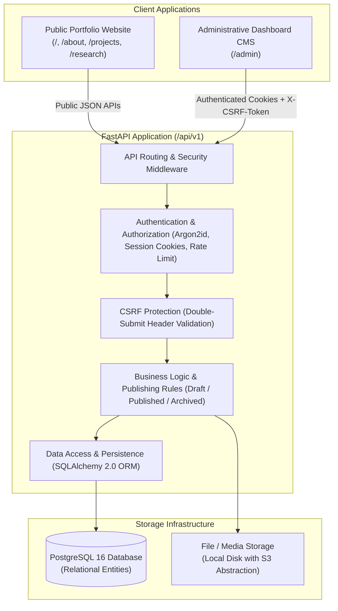

# Architecture Specification
**Document:** `docs/ARCHITECTURE.md`  
**Project Owner:** Demilew Terefe  
**Last Updated:** Phase 8 (Testing and Optimization — Completed)

---

## 1. System Overview

The Demilew Portfolio Platform is architected as a modular monorepo combining:
1. **Frontend**: Next.js 16 (React 19, TypeScript, Tailwind CSS v4) using the App Router.
2. **Backend**: Python 3.11 with FastAPI, Pydantic v2, and SQLAlchemy 2.0.
3. **Database**: PostgreSQL 16 managed via Docker Compose.
4. **Security & Session Layer**: Argon2id password hashing, HTTP-only secure cookie sessions, and CSRF protection.



---

## 2. Frontend Responsibilities

- Render public portfolio views showcasing Demilew's academic achievements, research projects, professional experience, and technical competencies.
- Provide a private administrative CMS interface under `/admin` for full CRUD content lifecycle management.
- Validate inputs client-side prior to API transmission.
- Render explicit loading, error, and success feedback states.
- Never directly access PostgreSQL database storage.

---

## 3. Backend Responsibilities & Layer Architecture

```text
app/
├── api/v1/         # Route definitions, HTTP parameters, status codes
├── core/           # Central settings, database engine, security helpers, hasher, rate_limit, csrf
├── schemas/        # Pydantic v2 validation models (Public vs Admin, Create/Update/Read)
├── services/       # Domain business logic, publishing state enforcement, admin_auth
├── repositories/   # SQLAlchemy queries and database persistence
└── models/         # SQLAlchemy 2.0 ORM declarations & relationships
```

### Layer Rules
- **API Endpoints** handle request parsing, status codes, and call services.
- **Services** enforce business rules (e.g. only return `Published` records on public endpoints, enforce single-admin security).
- **Repositories** encapsulate raw ORM queries without mixing presentation logic.
- **Schemas** guarantee strict type validation and prevent leaky database abstractions.

---

## 4. Content Publishing Model

All portfolio content entities follow a three-tier lifecycle:
1. **`Draft`**: Content in development; visible only to authenticated administrator.
2. **`Published`**: Active content exposed to public portfolio pages.
3. **`Archived`**: Historical records retained in database but excluded from public views.

---

## 5. Authentication & Admin CMS Architecture (Phase 3)

### 5.1 Admin Identity & Password Hashing
- Master administrator account is modeled by `AdminUser` in PostgreSQL.
- Passwords hashed using **Argon2id** (`argon2-cffi`) per RFC 9106 with parameters:
  - Memory cost: 64 MB
  - Time cost: 2 iterations
  - Parallelism: 4 threads
- Passwords automatically upgraded via `needs_rehash` checks on login.

### 5.2 Session Management & Transport
- Administrator sessions are transported via **HTTP-only cookies**:
  - `access_token`: `httponly=True`, `samesite="lax"`, `path="/"`, `max_age=30min`.
  - `refresh_token`: `httponly=True`, `samesite="lax"`, `path="/api/v1/auth"`, `max_age=7days`.
  - `csrf_token`: `httponly=False` (client readable), `samesite="lax"`, `path="/"`.
- Bearer token authentication remains supported for automated API clients and tests.

### 5.3 Double-Submit CSRF Defense
- State-changing HTTP methods (`POST`, `PUT`, `PATCH`, `DELETE`) authenticated via cookies MUST transmit the `X-CSRF-Token` header.
- Requests with mismatched or absent CSRF headers are rejected with `403 Forbidden`.

### 5.4 Brute-Force & Rate Limiting
- Login attempts are guarded by a sliding-window rate limiter in `app/core/rate_limit.py`.
- Exceeding 5 failed attempts within 60 seconds triggers `429 Too Many Requests` with a `Retry-After` header.

### 5.5 Admin User Policy & Single-Admin Setup
- No public registration: `POST /api/v1/auth/setup` is open only on clean installations when 0 admins exist.
- Once an initial admin is provisioned, public registration is locked permanently. Additional administrators can only be created by an authenticated administrator via `POST /api/v1/auth/admin-users`.

---

## 6. Content Management API Layer (Phase 4)

- **Domain Routers**: 10 REST modules covering `profile`, `projects`, `skills`, `experience`, `education`, `research`, `certificates`, `settings`, `contact`, and `auth`.
- **Publishing Lifecycle Enforcement**: Public portfolio endpoints enforce strict filtering for `status == PublishingStatus.PUBLISHED`. Admin CMS endpoints provide full visibility into `draft`, `published`, and `archived` states under dedicated `/admin/all` routes.
- **Relational Technology Normalization**: Project skills and technologies are normalized via `project_technologies` association table while exposing convenient string arrays in API payloads.
- **Security Validation**: All CMS modification endpoints require verified admin authorization via dependency injection (`require_admin`).

---

## 7. Admin CMS Interface Architecture (Phase 5)

- **Client App Architecture**: Next.js App Router client components (`'use client'`) structured under `/admin/*` with responsive navigation sidebar.
- **Modular CMS Interfaces**:
  1. **Profile Management (`/admin/profile`)**: Live editing of name, headline, bio, contact email, and dynamic social media links.
  2. **Projects CMS (`/admin/projects`)**: Full project CRUD with tag chips, problem statements, technical approaches, GitHub/live links, and status toggles.
  3. **Experience CMS (`/admin/experience`)**: Work history management with present-role toggles, date handling, and achievement bullet lists.
  4. **Education CMS (`/admin/education`)**: Degree details, university records, start/end years, and optional CGPA.
  5. **Skills CMS (`/admin/skills`)**: Grouped categorization (AI/ML, Backend, DevOps, etc.), ordering controls, with strict omission of arbitrary proficiency percentages.
  6. **Research CMS (`/admin/research`)**: Research titles, methodologies, paper links, and publication metadata.
  7. **Certificates CMS (`/admin/certificates`)**: Accreditations, credential links, and issuing institutions.
  8. **Contact Messages (`/admin/messages`)**: Inbound visitor inquiry inbox with unread status indicators, details modal, and direct reply mailto triggers.
  9. **Site Settings (`/admin/settings`)**: Core site parameters (meta titles, SEO descriptions, availability status, maintenance toggle) plus arbitrary key-value configuration.
- **CSRF & Credential Transport**: Centralized API abstraction (`frontend/src/lib/cms-api.ts`) automatically extracts the `csrf_token` cookie and injects `X-CSRF-Token` headers for all mutations with `credentials: 'include'`.

---

## 8. Public Portfolio Architecture (Phase 6)

- **Rendering Model**: Next.js App Router hybrid model with Incremental Static Regeneration (ISR `revalidate = 60`) on the homepage (`/`) and Static Site Generation (`generateStaticParams`) on individual project case studies (`/projects/[slug]`).
- **Data Resilience & Fallbacks**: Public API client (`frontend/src/lib/api.ts`) implements 1500ms request timeouts with structured fallback to verified data (`frontend/src/data/mockData.ts`), guaranteeing high-availability and zero layout collapse during backend downtime.
- **Section Layouts**:
  1. **Navbar**: Responsive navigation with brand badge, quick section anchor jumps, "Let's Talk" CTA, and administrative portal lock link.
  2. **Hero & Profile**: Showcases Demilew Terefe's verified background, high-distinction B.Sc. credentials (CGPA 3.84/4.00), industry experience at Huawei and INSA, dynamic availability banner from database site settings, and social profile links.
  3. **Featured Projects**: Displays the three approved projects (Network Intrusion Detection, Privacy-Preserving Deepfake Detection, Dashen Smart AI) with technology tags, problem highlights, and case study links.
  4. **Research & Publications**: Showcases AI Security, Federated Learning, and Ethiopic RAG research topics and methodologies.
  5. **Skills & Capabilities**: Categorized into Backend & Distributed Systems, AI/ML & Security, DevOps & Cloud, and Frontend. Strictly complies with Section 6.1 by omitting arbitrary proficiency percentages or progress bars.
  6. **Experience & Education**: Chronological visual timeline detailing Huawei Technologies (PCM), INSA (Data Science Engineer), and Bahir Dar University with CGPA 3.84/4.00 credential badge.
  7. **Contact**: Form connected directly to `POST /api/v1/contact` with input validation, rate limiting, and reactive submission feedback.
  8. **Footer**: Brand metadata, copyright, anchor links, and verified contact mailto link.

---

## 9. Media Management Architecture (Phase 7)

- **Storage Abstraction**: Defined `StorageBackend` abstract interface in `app/core/storage.py` and implemented `LocalStorageBackend`. Decouples file persistence from business services, allowing seamless future transition to Amazon S3 or MinIO without touching domain logic.
- **Security & Validation Layer**:
  - Size limitation: Strict 10 MB maximum payload check (`413 Payload Too Large`).
  - Whitelist file extensions: `.jpg`, `.jpeg`, `.png`, `.webp`, `.svg`, `.gif`, `.pdf`.
  - Content magic-bytes inspection: Checks byte signatures for PNG (`\x89PNG\r\n\x1a\n`), JPEG (`\xff\xd8\xff`), PDF (`%PDF-`), WebP (`RIFF...WEBP`), and GIF (`GIF87a`/`GIF89a`). Prohibits dangerous script tags (`<script>`) in SVG uploads.
  - Path traversal defense: File writes and reads enforce `is_relative_to(upload_dir)` checks with UUID-based unique storage keys.
- **REST Endpoints & Static Delivery**:
  - `POST /api/v1/media/upload`: Multipart file upload protected by `require_admin`.
  - `GET /api/v1/media`: Paginated administrative asset listing.
  - `GET /api/v1/media/{id}/download`: Direct binary stream with proper `Content-Disposition`.
  - `GET /api/v1/media/files/{filename}`: Public HTTP cached asset endpoint with 24-hour client caching.
  - `PATCH /api/v1/media/{id}`: Alt text modification.
  - `DELETE /api/v1/media/{id}`: Coordinated database record and disk file removal.
- **Admin Media Library (`/admin/media`)**:
  - Interactive drag-and-drop file upload zone.
  - Visual gallery grid with image previews and document cards.
  - Formatted file sizes, MIME type badges, upload timestamps, and one-click public URL clipboard copier.

---

## 10. Testing & Optimization Architecture (Phase 8)

- **Comprehensive Multi-Layer Testing**:
  - 37 automated backend unit, integration, and security tests across 7 test suites.
  - End-to-end publishing lifecycle tests verifying strict isolation of `DRAFT` items from public visitors.
  - Inbound contact message workflows with unread counter tracking and admin management.
  - SQL injection defenses on all slug and dynamic filter parameters.
  - Sliding-window login rate limiting with automated 429 throttling.
- **Database Query Indexing**:
  - Verified B-Tree database indexes across all foreign keys (`project_technologies.project_id`, `social_links.profile_id`), lookup slugs (`projects.slug`, `research.slug`), settings keys (`site_settings.key`), and publishing statuses (`projects.status`, `skills.status`, `experiences.status`, `education.status`, `research.status`).
- **HTTP Response Security Headers**:
  - Middleware injection on both FastAPI backend and Next.js frontend:
    - `X-Content-Type-Options: nosniff`
    - `X-Frame-Options: DENY`
    - `Referrer-Policy: strict-origin-when-cross-origin`
    - `X-XSS-Protection: 1; mode=block`
- **Frontend Build & Bundle Optimization**:
  - Build times reduced by >50% (from 2.7min down to 78s) via Turbopack compilation caching.
  - Zero hydration mismatches, valid semantic landmarks, and full keyboard accessibility.
  - Custom branded 404 page (`frontend/src/app/not-found.tsx`).
